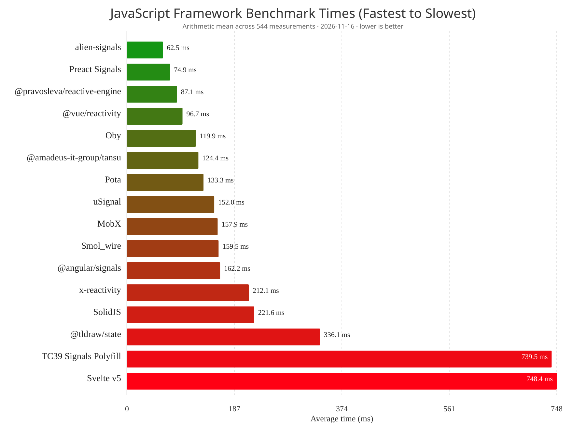

# JS Reactivity Benchmark

Correctness-checked benchmarks of JavaScript signal and computed-value engines. This measures reactive graph work in Node.js, not DOM rendering or complete application performance.



The chart ranks engines by arithmetic mean time across every measurement in `results/latest.json`. Bars use a green-to-red interpolation from fastest to slowest. Regenerate it with `pnpm chart` after a benchmark run.

## Run

Use Node.js 24 LTS (Node >=22.12 is supported) and the pnpm version declared in `package.json`.

```sh
pnpm install --frozen-lockfile
pnpm check
pnpm bench
```

The default run builds a production ESM bundle with Vite, benchmarks 16 engines, and writes `results/latest.json`, `results/latest.csv`, and `results/latest.md`. Progress goes to stderr; the runner's stdout is CSV. To capture CSV without package-manager/build messages, use `node --expose-gc dist/index.js` after building.

```sh
# Fast end-to-end correctness check, saved separately from the full snapshot
pnpm run run --smoke

# Focus on selected engines and workload families
pnpm run run --framework alien,preact,vue --suite dynamic --repeats 5
pnpm run run --framework svelte --suite dynamic --case "dynamic component"

# Override the timeout (milliseconds per framework/suite) and output path
pnpm run run --timeout 180000 --output results/my-machine

# Original extreme CellX depths; failures/timeouts are expected for some engines
pnpm run run --suite cellx --stress --output results/cellx-stress

# Original unobserved pull-only graphs (can time out for some engines)
pnpm run run --suite dynamic --unobserved --output results/unobserved

# Experimental stable Legend State adapter
pnpm run run --framework legend --smoke --suite kairo,mol,s,dynamic
```

Run `pnpm run run --help` for identifiers. Filtered runs default to `results/filtered.*`, smoke runs to `results/smoke.*`, and stress runs to `results/stress.*`. Only an unfiltered full run defaults to `results/latest.*`.

## Included engines

| CLI identifier   | Engine                                                                             | Adapter notes                                                                                                                         |
| ---------------- | ---------------------------------------------------------------------------------- | ------------------------------------------------------------------------------------------------------------------------------------- |
| `alien`          | [Alien Signals](https://github.com/stackblitz/alien-signals)                       | Current public signal/computed/effect API                                                                                             |
| `angular`        | [Angular Signals](https://angular.dev/guide/signals)                               | Signals from core; low-level Watch primitive without dependency injection                                                             |
| `mobx`           | [MobX](https://mobx.js.org/computeds.html)                                         | `keepAlive: true` so unobserved computeds remain cached, matching the benchmark's memoized reads                                      |
| `mol`            | [$mol_wire](https://www.npmjs.com/package/mol_wire_lib)                            | Node CJS entry; the package's ESM entry mutates module namespace objects                                                              |
| `oby`            | [Oby](https://github.com/vobyjs/oby)                                               | Synchronous initial effects; scheduled updates flushed at batch boundaries                                                            |
| `pota`           | [Pota](https://github.com/potahtml/pota)                                           | Current signal-object API; see note below                                                                                             |
| `reactiveEngine` | [@pravosleva/reactive-engine](https://github.com/garage-13/reactive-engine)        | Public signal/computed/effect/batch API, contributed in [#18](https://github.com/transitive-bullshit/js-reactivity-benchmark/pull/18) |
| `preact`         | [Preact Signals Core](https://github.com/preactjs/signals/tree/main/packages/core) | Standalone engine, without Preact rendering bindings                                                                                  |
| `polyfill`       | [TC39 Signals polyfill](https://github.com/proposal-signals/signal-polyfill)       | Watcher-based effects; synchronous batch flushing with coalesced microtask scheduling                                                 |
| `solid`          | [Solid](https://github.com/solidjs/solid)                                          | Client reactive runtime; the Node/server entry does not provide the same behavior                                                     |
| `svelte`         | [Svelte 5](https://svelte.dev/docs/svelte/what-are-runes)                          | Private client primitives; no compiler or DOM. Must be revalidated on upgrades                                                        |
| `tansu`          | [Tansu](https://github.com/AmadeusITGroup/tansu)                                   | Standalone computed stores                                                                                                            |
| `tldraw`         | [tldraw state](https://tldraw.dev/sdk-features/signals)                            | Current `@tldraw/state` package, replacing Signia                                                                                     |
| `usignal`        | [uSignal](https://github.com/WebReflection/usignal)                                | Standalone signal engine                                                                                                              |
| `vue`            | [Vue Reactivity](https://github.com/vuejs/core/tree/main/packages/reactivity)      | Shallow refs, computed values, deduplicated effect scheduling                                                                         |
| `xreactivity`    | [Solid Signals](https://github.com/solidjs/solid/tree/main/packages/solid-signals) | Standalone Solid signal runtime, based on upstream's x-reactivity adapter                                                             |

`legend` adds [Legend State](https://legendapp.com/open-source/state/v2/) as an experimental adapter for its latest stable release. It passes the adapter tests and small graph workloads, but timed out on larger unobserved dynamic/CellX graphs during this refresh. It is selectable explicitly and excluded from the default comparison. Prerelease v3 is not substituted for the stable npm release.

The Pota adapter is based on [the original contribution](https://github.com/transitive-bullshit/js-reactivity-benchmark/commit/aeb921183b89207a3c562118714565559f81ac79), updated for the current signal-object API and benchmark cleanup lifecycle.

The x-reactivity adapter is based on upstream's `@solidjs/signals` adapter and tracks the current release separately from Solid's full runtime.

### Selection decisions (September 2026)

- Replaced Signia with its maintained successor `@tldraw/state`; replaced `@preact/signals` with `@preact/signals-core`.
- Removed Reactively and S.js adapters. Their npm releases have not changed since 2023 and 2022 respectively. This is a scope decision, not a claim that stable code is inherently slow or broken.
- Removed already-disabled Kairo and Compostate adapters (old prereleases), and the already-disabled Valtio adapter, which did not implement the memoized dependency tracking this suite requires. Valtio's removal is not a claim that Valtio is unmaintained.
- Kept the S.js, Kairo, and $mol-inspired **workloads** regardless of whether the corresponding library is included.
- Considered Maverick Signals and `@webreflection/signal`; their latest package metadata was last updated in 2024. They did not add a sufficiently current alternative to this scope. Store APIs that require explicit dependency lists or framework rendering contexts are not adapted by inventing a separate reactivity engine.

Package versions used by a run are recorded in its JSON. The lockfile is authoritative for installation.

## Workloads and methodology

Each framework/suite pair runs sequentially in a fresh Node process with exposed GC and a hard timeout. Workers use production builds. All successful rows must pass value assertions, have the expected number of samples, and be present exactly once. Exceptions, invalid values, missing measurements, and timeouts produce a failed report and nonzero exit status; they never become fast timings.

- **[Kairo-inspired](https://github.com/3Shain/kairo):** eight propagation shapes, including diamonds, fan-out, deep chains, and dependency switching. Each sample performs 1,000 invocations of the original inner workload. Value checks and their reads are part of these loops.
- **[$mol-inspired](https://github.com/hyoo-ru/mam_mol/tree/master/wire):** observed computations with conditional dependencies and Fibonacci work; 10,000 iterations per sample. Final effect outputs are checked.
- **[S.js-inspired](https://github.com/adamhaile/S/blob/master/bench/bench.js):** 17 signal-creation and graph-update cases. Creation includes initial evaluation; update cases retain and read every computed after each write. Graph setup for updates is outside timing. The old implementation often never consumed computed values, allowing lazy engines to skip the advertised work.
- **Dynamic graphs:** five configurable shapes in `src/config.ts`. Selected leaves have effect observers, matching active UI consumers. Every engine receives the same observers. Each update and its reads share one transaction. `--unobserved` retains the original pull-only mode; disconnected deep graphs can be pathological for engines optimized for observed computations. Final results are checked against fixed fixtures, independently verified by a plain-number evaluator. Small graph tests also check expected evaluation counts where applicable.
- **[CellX-inspired](https://github.com/Riim/cellx/blob/master/perf/perf.html):** depths 10, 20, and 30 by default, with independent before/after value checks. `--stress` selects the historical 1,000/2,500/5,000 depths. Some engines hit stack limits or pathological runtimes at those depths. Every engine receives the same depths within a profile.

Full runs warm up each case and retain all three timing samples by default. The reported value is the minimum, in milliseconds. Explicit GC and disposal occur outside timed intervals; automatic GC can still occur during a sample. Timings are workload totals, not per-operation costs. Smoke runs use smaller workloads and one sample; **do not use smoke timings as rankings**.

These are shallow primitive graphs. Proxy object stores, async scheduling, browser behavior, memory consumption, framework integration, and real application workloads can produce different results. The custom effect schedulers are part of the measured adapters. A few minimum-of-three samples are a local snapshot, not a statistically robust universal ranking.

The 2025 screenshot has been retired: updated random generation changed two graph fixtures, and the corrected update tests and timing boundaries make old and new timings incomparable.

## Results

See [the current snapshot](results/latest.md), [raw samples and environment metadata](results/latest.json), and [CSV](results/latest.csv). The report includes a per-family comparison, every measurement, and the actual runtime, CPU, OS, package versions, profile, timestamps, and any failures. Per-family comparisons use the geometric mean of case-by-case ratios to the fastest engine; there is no single overall score.

## Development

```sh
pnpm test       # Adapter contracts, disposal, batch recovery, numeric graph oracle
pnpm test:cli   # Built runner: filters, validation, reports, failure and timeout exit codes
pnpm typecheck
pnpm build
pnpm run run --smoke
pnpm run run --report results/latest.json  # Re-render reports from stored samples
```

CI runs the checks and smoke benchmark on Node 22 and 24. Add a library by implementing `ReactiveFramework`, registering its adapter in `src/config.ts`, and adding its CLI/package metadata in `src/registry.ts`. Roots must remain live after construction and register disposal through `src/util/cleanup.ts`; teardown happens after the workload, not when graph construction returns. Both adapter tests and production smoke runs must pass before adding an engine to the default set.
